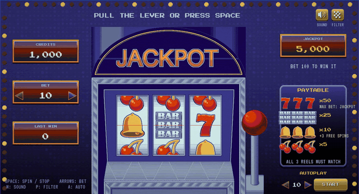
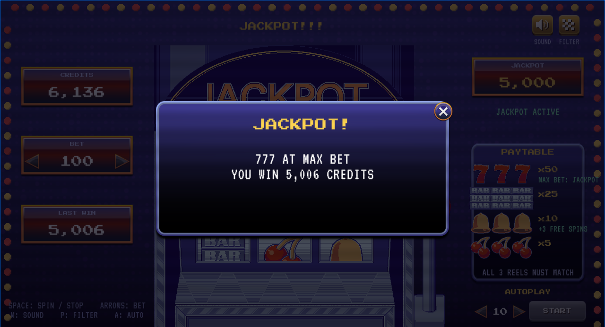

# Retro Jackpot

A three-reel slot machine made in Unity 6 with a retro pixel-arcade look. It has a pull lever, marquee bulbs, chiptune sounds, free spins, autoplay and a progressive jackpot.

**▶ Play it in your browser: https://whenommmm.github.io/retro-jackpot/**



I made it for the Underpin Services Unity Slot Game assignment.

---

## Game overview

You start with 1,000 credits. Pick a bet of 10, 50 or 100 and pull the lever. You win when all three reels stop on the same symbol on the payline, which is the middle row.

| Line | Pays | Chance per spin |
|---|---|---|
| 7 7 7 | 50× bet, **or the progressive jackpot at max bet** | 1 in 1,000 |
| BAR BAR BAR | 25× bet | 1 in 125 |
| Bell Bell Bell | 10× bet **+ 3 free spins** | 1 in 37 |
| Cherry Cherry Cherry | 5× bet | 1 in 16 |

About one spin in ten wins. If you run out of credits, the machine offers you a free refill.

### Controls

| Action | Keyboard | Mouse or touch |
|---|---|---|
| Spin | Space or Enter | Click the lever |
| Stop the reels early (slam stop) | Space during a spin | Click the lever during a spin |
| Change the bet | ← → (or ↓ ↑) | Arrow buttons on the BET box |
| Close a popup | Space or Enter | The ✕ button |
| Start or stop autoplay | A | START / STOP under the paytable (its arrows pick 10, 25 or 50 spins) |
| Sound on or off | M | The speaker button, top right |
| Pixel filter on or off | P | The grid button, top right |

---

## How to run the WebGL build

**Online:** open **https://whenommmm.github.io/retro-jackpot/**. A GitHub Actions workflow publishes `Build/WebGL` to GitHub Pages whenever the build changes.

**Locally:** the build is in [`Build/WebGL/`](Build/WebGL). Browsers won't run a Unity WebGL build from `file://`, so serve the folder over HTTP:

```bash
cd Build/WebGL
python3 -m http.server 8000
```

Then open <http://localhost:8000>. Any static server works, such as `npx serve`.

The build is Gzip-compressed (about 11 MB) with Unity's decompression fallback turned on. It runs on any static host and needs no special server headers.

## How to open the project in Unity

1. Use **Unity 6000.3.2f1** (Unity 6.3). The project uses the Built-in Render Pipeline, and its only packages are uGUI, TextMeshPro, 2D Sprite and the Test Framework.
2. Open `Assets/Scenes/SlotMachine.unity` and press **Play**.
3. The **Slot Machine** menu has three entries:
   - **Rebuild Assets And Scene** regenerates the import settings, sprite slicing, animations, prefabs and scene from code.
   - **Build WebGL** writes the release build to `Build/WebGL`.
   - **Build WebGL (QA development build)** writes a build with the testing shortcuts to `Builds/WebGL-QA`, which git ignores.

**Testing shortcuts.** These work in the Editor and in development builds only, and are compiled out of the release build. Press a key, then spin:

| Key | Forces |
|---|---|
| 1 | 7 7 7 (raise the bet to 100 first to see the jackpot) |
| 2 | BAR BAR BAR (a big win) |
| 3 | Bell Bell Bell (free spins) |
| 4 | Cherry Cherry Cherry (a small win) |
| 5 | 7 7 BAR (a near miss with anticipation) |
| 0 | Empties the wallet (to see the refill offer) |

---

## How the brief is covered

| Brief | How it's met |
|---|---|
| **Winning logic**: the player wins when all slots show the same symbol | `SlotEngine.AllMatch` checks that every reel shows the same symbol on the payline. It is unit-tested. |
| **Smooth reel animations** | Each `ReelView` winds up, accelerates, blurs, brakes onto its target with an overshoot and settles. The reels stop one after another, and the last one waits longer when a win is still possible. Details are under [Reel animation](#reel-animation). |
| **Clean symbol display** | Symbols sit on a fixed 96 px grid, snapped to whole pixels and point-filtered so they stay crisp. The stopped symbol is always exactly centred on the payline. |
| **Randomized outcomes from a proper RNG** | Each reel's stop is drawn uniformly at random from its strip, behind an `IRandomSource` interface. The result is decided before the reels move, and a chi-square test checks the generator is uniform. |
| **Winning combinations and payouts** | The paytable lives in a ScriptableObject, and the payouts are unit-tested. The exact odds and return are calculated and checked against simulations of 300,000 and 1,000,000 spins. |
| **Bonus features** | A progressive jackpot, free spins, autoplay with automatic stops, slam stop, anticipation, win celebrations that scale with the win, and a refill offer. See [Bonus features](#bonus-features). |
| **OOP, naming and comments** | The rules are a pure C# core, kept separate from the Unity views, with one job per class. Public APIs have XML doc comments, and the tricky parts (braking, the maths, the jackpot) are explained inline. |
| **Folder structure** | `Assets/Scripts`, `Prefabs`, `Animations`, `UI` and `Sounds`, plus `Data`, `Scenes`, `Shaders`, `Tests` and `WebGLTemplates`. |
| **WebGL build in `/Build/WebGL`** | It's committed and also deployed to GitHub Pages. |
| **Meaningful commit history** | One commit per step, from the project setup to autoplay and this README. |

---

## Bonus features

- **Progressive jackpot.** 5% of every bet goes into the pool shown at the top right. Three 7s at max bet (100) win the whole pool. The pool starts at 5,000, which is what the 777 line pays at max bet, so betting max never pays less. A jackpot shakes the screen, flashes the JACKPOT sign letters, sets the bulbs chasing and plays a fanfare.
- **Free spins.** Three bells pay 10× and give 3 free spins at the same bet. They play by themselves and can retrigger, and a summary shows what they won.
- **Autoplay that looks after the player.** Pick 10, 25 or 50 spins and press START (or A). The banner counts "SPIN 3 OF 10" and the panel counts down. It stops by itself for a big win, the jackpot or free spins, so they're never missed, and once you're down half the balance you started with. It also stops if the bet can't be paid, or when you press STOP; the spin in progress still finishes. The spin counts and the loss limit are designer settings in the config, and the panel shows the limit before you start.
- **Slam stop.** Press Space or click the lever while the reels spin to stop them early. The result was decided when the spin started, so stopping early only skips the wait and can't change the result.
- **Anticipation.** When the first two reels match, the last reel spins 1.2 seconds longer. While it spins, its window glows, a rising tone plays and the banner says "COME ON...!".
- **Win celebrations that scale.** A win lights the payline, pulses the winning symbols and counts the credits up coin by coin. A win of 25× the bet or more also opens a BIG WIN popup, and the jackpot gets the full show.
- **Marquee lights.** 81 bulbs run a different pattern for idle, spinning, a win and the jackpot.
- **Free-play refill.** When you can't afford a spin, a YES/NO popup offers to top you back up to 1,000. If you can still afford a smaller bet, the bet drops to it.
- **Retro presentation.** A pixel filter with scanlines, pixel fonts, 12 chiptune sound effects and a loading screen made of marquee bulbs. Sound and the filter each have an on-screen button as well as a key (M, P), and mute is remembered between visits.



---

## The maths

Each reel is a strip of 20 symbols: 8 cherries, 6 bells, 4 BARs and 2 sevens. That's how a mechanical three-reel machine works. A spin picks one stop on each strip, uniformly at random. So the chance of a symbol on one reel is its count ÷ 20, and the chance of three of a kind is that number cubed.

| Line | Chance | Pays | Return per credit bet |
|---|---|---|---|
| Cherry ×3 | 0.4³ = 0.064 | 5 | 0.320 |
| Bell ×3 | 0.3³ = 0.027 | 10, + 3 free spins | 0.270 |
| BAR ×3 | 0.2³ = 0.008 | 25 | 0.200 |
| 7 ×3 | 0.1³ = 0.001 | 50 | 0.050 |
| **Total** | **0.100 (hit rate 10%)** | | **0.840** |

- **Free spins** add 0.027 × 3 = 0.081 spins per spin. They can retrigger, so each paid spin is worth 1 / (1 − 0.081) spins. That makes the **return to player 0.84 / 0.919 = 91.4%** at any bet.
- **At max bet** the jackpot adds to that. The 5,000 seed pays the same as the 50× line it replaces, and the 5% contribution comes back to players through the pool. So someone who always bets max gets **96.4%** back over the long run.
- **Strip order.** Each reel has its own fixed order, and no symbol sits next to a copy of itself. The rows above and below the payline therefore always look varied.

`SlotMath` works these numbers out from the live strips and paytable, so they stay correct if the config changes. `SlotMathTests` checks them against real simulated play.

---

## Architecture

```
Core: pure C#, no UnityEngine (unit-tested)    Unity layer: MonoBehaviours
──────────────────────────────────────────     ─────────────────────────────────────────
SlotRules        every tunable number           SlotMachineController   runs a spin, start to finish
ReelStrip        the symbols on a reel            ├─ ReelView ×3, LeverView, WindowGlow
Paytable         what each line pays              ├─ HudView, PaytableView, PopupView
CreditBank       credits, bet, jackpot pool       ├─ AutoplayView, IconToggleView ×2
SlotEngine       takes the bet, picks, pays       ├─ AudioService
SlotMath         exact odds and return            └─ MarqueeLights, PaylineView, ScreenShake,
AutoplaySession  when autoplay stops                 JackpotSignView, RetroScreenEffect
```

A spin goes like this:

1. **Decide.** `SlotMachineController` calls `SlotEngine.TrySpin`. The engine takes the bet (or uses a free spin), picks a stop on each strip and settles the win. The result is final before anything moves.
2. **Animate.** The reels start one after another. After a minimum spin time, each reel is told the stop index it must land on, left to right. If the first two reels match, the last one gets the anticipation delay.
3. **Present.** Once every reel has landed, the controller shows the result: the payline glow, the count-up, popups, then any free spins.

Autoplay reuses this round as it is. After each round it reports the new balance, and whether a popup was shown, to `AutoplaySession`, which decides whether to start another spin.

A few decisions behind this:

- **The animation can't change the outcome.** The Core assembly is built with `noEngineReferences`, so the rules can't depend on Unity. They are tested on their own, with a scripted random source that forces exact results.
- **Designers can tune without code.** The paytable, strip counts, bets, jackpot and autoplay settings live in `Assets/Data/SlotMachineConfig.asset` and the four `Symbol_*.asset` files. Each config is checked when the game starts; for example, every symbol on a strip must be in the paytable.
- **The scene is built by code.** The editor scripts in `Assets/Scripts/Editor` generate the import settings, sprite slicing, animator controllers, prefabs and the scene. The layout is reproducible and reviewable as C# instead of hand-placed scene data. The generated files are committed, so the project opens ready to play.

## Reel animation

Each reel has five symbol cells, recycled as they scroll off the window, so the strip looks endless.

1. **Wind-up.** The reel dips back 0.3 of a symbol in 0.12 s, as if the lever kicked it.
2. **Spin.** It accelerates to 20 symbols a second. Above 9 a second, the cells switch to motion-blurred versions of each symbol, and a tick plays for every symbol that passes.
3. **Brake.** Landing on the right symbol needs the target exactly 2.5 symbols ahead when braking starts. At full speed the blurred strip can't be read, so the reel quietly re-aligns itself to that point in one frame. That way every reel stops on time, in order, without an extra lap.
4. **Land.** It decelerates with an ease-out curve, overshoots by 0.16 of a symbol, then settles back over 0.14 s. That's the mechanical clunk, with a stop sound.
5. **Pixel snap.** Positions snap to whole pixels, so the art never shimmers.

The reels start 0.06 s apart and stop 0.32 s apart. A slam stop brakes over 1.1 symbols and stops the reels 0.06 s apart.

## Retro look

- **Resolution.** The canvas uses a 1280×720 reference, so the provided 816×624 machine art draws 1:1.
- **Pixel filter.** `RetroScreenEffect` point-samples the frame down to 720 virtual rows and back up, with faint scanlines and a vignette. Pixels stay square and sharp at any window size. It's subtle on purpose: retro, but every number stays easy to read.
- **Fonts.** Press Start 2P for headings and VT323 for readouts, as static TextMeshPro atlases.
- **Generated assets.** `Tools/generate_retro_assets.py` creates the sound effects (square waves, noise and arpeggios) and the extra sprites: the motion-blurred symbols, the bulb, the glow frames, the pixel icons, and blank gold buttons made from the provided YES/NO art.

---

## Project structure

```
Assets/
  Animations/       Lever, popup and jackpot-sign animator controllers and clips
  Data/             SlotMachineConfig and one SymbolDefinition per symbol (ScriptableObjects)
  Prefabs/          Reel, InfoBox, PaytableRow, Popup
  Scenes/           SlotMachine.unity
  Scripts/
    Core/           Rules, RNG, reel strips, paytable, credit bank, spin engine, maths, autoplay (pure C#)
    Gameplay/       Controller, reels, lever, config ScriptableObjects, QA random source
    UI/             HUD, paytable panel, popups, autoplay panel, icon toggles
    Effects/        Marquee lights, payline glow, screen shake, jackpot sign, retro filter
    Audio/          Audio service and button click sounds
    Editor/         Asset, scene and build automation
  Shaders/          RetroUpscale (pixel upscale, scanlines, vignette)
  Sounds/           12 synthesised chiptune effects
  Tests/EditMode/   NUnit tests for the Core
  UI/               Provided art (renamed by purpose), pixel fonts, generated sprites
  WebGLTemplates/   The custom loading page
Build/WebGL/        Release WebGL build
Docs/               Images for this README
Tools/              generate_retro_assets.py
```

## Tests

There are 94 EditMode tests, all in the Core:

- every payout, and the bet, credit and jackpot rules
- how free spins trigger and retrigger
- when autoplay stops: spin count, features, loss limit, an unaffordable bet and the player's stop
- how the reel strips are built
- the exact odds
- two simulation tests (300,000 base-game spins and 1,000,000 max-bet spins)
- a chi-square uniformity test for the RNG

Run them from **Window → General → Test Runner**, or headless:

```bash
Unity -batchmode -projectPath . -runTests -testPlatform EditMode -testResults results.xml
```

---

## Thought process

1. **I started with the rules, not the visuals.** A slot machine is a maths product with a show on top. I got the outcome model right first, so everything after it is just presentation. I chose the reel-strip model that real three-reel machines use over "pick a random symbol for each reel". It makes the odds explicit and tunable per symbol, and every stop is a real position on a real strip.
2. **Decide first, animate after.** Settling the result before the reels move keeps the game fair and testable. It also makes slam stop and anticipation honest: they change the pacing, never the outcome.
3. **I balanced for feel.** A 1-in-10 hit rate keeps small wins coming, while the 777 line stays rare enough to matter. 91.4% is in the range of real machines, and the jackpot rewards betting max.
4. **Game feel is many small things.** Wind-up, blur, a stagger between stops, overshoot, ticks and clunks, the near-miss delay, a count-up, and celebrations that grow with the win. Each one is small, but together they make the machine feel physical.
5. **I leaned into the theme without losing clarity.** The provided art already had a pixel feel. I added pixel fonts, a scanline filter, marquee bulbs and chiptune sound, but kept the resolution high enough that every number reads instantly.
6. **I tested it as a player.** I played every outcome in browser builds using the QA shortcuts, and fixed what I found. For example, reels could land out of order at first, and the jackpot paid less than the 777 line at max bet. The second one is why the pool now starts at 5,000.

**What I'd add next:** more paylines with line selection, saving the balance between sessions, and a portrait layout for phones.

## How I built it

I'm a game designer, and I build with an AI coding assistant (Claude Code). I set the direction: the retro arcade theme, the features and how each moment should feel. I then play-tested every build. The AI wrote most of the code to that brief.

## Credits

- The slot machine, symbol, button and panel art were provided with the assignment.
- Press Start 2P © 2012 The Press Start 2P Project Authors, and VT323 © 2011 The VT323 Project Authors. Both are under the SIL Open Font License 1.1, and the licences are in `Assets/UI/Fonts/`.
- All sound effects were synthesised for this project by `Tools/generate_retro_assets.py`.
